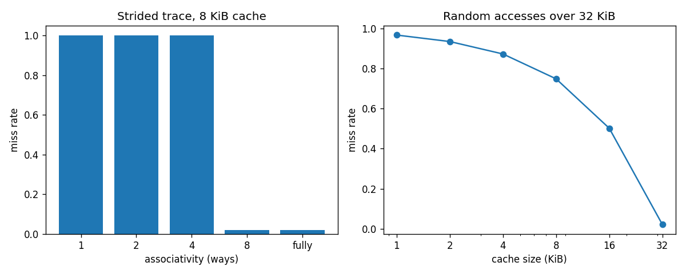

# cache-simulator

Trace-driven cache simulator in Python: direct-mapped, n-way set-associative and fully associative caches,
LRU / FIFO / random replacement, write-back with write-allocate, Hill's **3C miss classification** and a two-level hierarchy with AMAT.

## Installation and quick start

```bash
git clone https://github.com/nimaazamii/cache-simulator.git
cd cache-simulator
pip install -e ".[dev]"
pytest -q
```

```python
from cachesim import Cache, traces
cache = Cache(size_bytes=4096, block_bytes=64, associativity=4, policy="LRU")
stats = cache.run(traces.matrix_traversal(64, 64, order="col"))
print(f"miss rate {stats.miss_rate:.3f}")
```
Output: `miss rate 1.000`

`python examples/run_experiments.py` regenerates `results/experiments.json` and `results/experiments.png`.

## Design

* `Cache(size_bytes, block_bytes, associativity, policy, seed)`: `associativity=1` is direct-mapped, `0` fully associative. Sizes must be powers of two.
* Each set is an ordered map from tag to dirty bit; LRU reorders on hits, FIFO does not, RANDOM uses a seeded generator.
* `classify_misses` compares against a same-size fully associative LRU cache: misses that also miss there are *capacity* misses, those that hit there are *conflict* misses, first references are *compulsory*.
* `TwoLevelHierarchy`: L2 only sees L1 misses; `amat = t_L1 + m_L1 (t_L2 + m_L2,local * t_mem)`.

## Experiments (synthetic traces, real run)

1. **Associativity vs conflict misses.** 8 addresses 4 KiB apart touched 50 times (400 accesses), 8 KiB cache, 64 B blocks (power-of-two stride makes them collide):

| ways | miss rate |
|---|---|
| 1 | 1.000 |
| 2 | 1.000 |
| 4 | 1.000 |
| 8 | 0.020 |
| fully | 0.020 |

   Direct-mapped breakdown: 8 compulsory, 0 capacity, **392 conflict** misses.

2. **Cache size** (random accesses over 32 KiB, 50,000 accesses, 4-way LRU, 32 B blocks):

| size | miss rate |
|---|---|
| 1 KiB | 0.967 |
| 2 KiB | 0.935 |
| 4 KiB | 0.873 |
| 8 KiB | 0.749 |
| 16 KiB | 0.502 |
| 32 KiB | 0.020 |

3. **Replacement policy**, loop over 10 blocks in an 8-block fully associative cache (hit rate): LRU 0.000, FIFO 0.000, random 0.604 (LRU and FIFO are worst-case on cyclic access slightly larger than the cache).
4. **Matrix traversal**, 64x64 ints, 4 KiB 4-way cache with 64 B blocks: row-major miss rate 0.0625, column-major 1.0000.
5. **Two-level AMAT** (L1 4 KiB 2-way, L2 64 KiB 8-way, 64 B blocks, 1/10/100 cycles, 256x256 matrix): row-major 7.875 cycles, column-major 111.0 cycles.



## Testing
`pytest -q` runs 16 tests: hand-traced mappings, LRU vs FIFO on a known trace, write-back accounting, 3C categories on constructed traces, AMAT formula, hierarchy invariants and input validation.

## Limitations and future work
Only address traces (no timing of the pipeline), no real program traces, no prefetching, no inclusion/exclusion policies, no cache coherence (a natural extension towards MESI), uniform block size. Latencies in the AMAT example are illustrative.

## References
* Hennessy and Patterson. *Computer Architecture: A Quantitative Approach*.
* Hill and Smith (1989). Evaluating associativity in CPU caches. *IEEE Trans. Computers* 38(12):1612-1630.

## License
MIT, see `LICENSE`.
